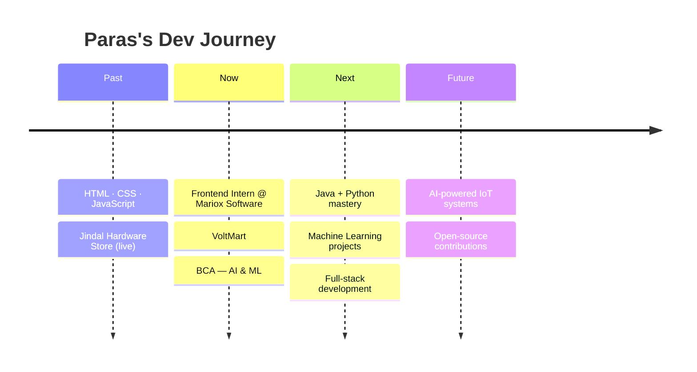

<!-- ═══════════════ HEADER ═══════════════ -->
<div align="center">


<a href="https://github.com/parasjindal921-sketch">
  
</a>

<br/>


</div>

---

## ⚡ Quick Boot Sequence

```js
const paras = {
  name: "Paras Jindal",
  degree: "BCA — Artificial Intelligence & Machine Learning",
  university: "Haridwar University",
  experience: {
    company: "Mariox Software",
    role: "Frontend Web Development Intern",
    shipped: "VoltMart — rapid electronics delivery storefront"
  },
  craft: ["HTML", "CSS", "JavaScript", "Responsive UI"],
  levelingUp: ["Java", "Python", "Machine Learning", "Full-Stack"],
  hardware: ["ESP32", "Sensors", "IoT"],
  motto: "Learn. Build. Innovate. Repeat."
};
```

<table>
<tr>
<td width="50%">

### 🎓 Currently
- 📚 Pursuing **BCA in AI & ML**
- 🧠 Diving deeper into **Python + ML**
- ☕ Strengthening **Java** fundamentals
- 🌐 Moving from frontend → **full-stack**

</td>
<td width="50%">

### 🎯 Looking For
- 💼 Internships & junior dev roles
- 🤝 Open-source collaborations
- 🛠️ Real-world projects to build
- 🌲 IoT + AI ideas worth solving

</td>
</tr>
</table>

---

## 💼 Experience

<table>
<tr>
<td>

### 🚀 Frontend Web Development Intern
**🏢 Mariox Software** &nbsp;|&nbsp; 🗓️ `<Month Year> – <Month Year>` &nbsp;|&nbsp; 💻 Web Development

During my internship I worked on building responsive, user-friendly web interfaces and turned an idea into a working e-commerce frontend.

**What I did**
- 🌐 Built frontend pages using **HTML, CSS & JavaScript**
- 📱 Designed **responsive, mobile-friendly** layouts
- 🛒 Developed an **e-commerce website concept** end-to-end
- 🧰 Worked daily in **VS Code, Git & GitHub**
- 🚀 Delivered the internship project **VoltMart**

</td>
</tr>
</table>

### ⚡ Internship Project — VoltMart

> *"Electronics at the speed of need."*

| | |
|---|---|
| **What** | Electronics shopping & rapid-delivery website |
| **Concept** | ⏱️ 30-min delivery for small electronics · 🚚 1-hour delivery for large appliances |
| **Features** | Product categories · Shopping cart UI · Responsive layout · Clean shopping flow |
| **Stack** |    |

<sub>ℹ️ Delivery times describe the project concept, not a live delivery guarantee.</sub>

---

## 🧪 Featured Projects

<div align="center">

| 🛒 Jindal Hardware Store | ⚡ VoltMart | 🌲 Smart Forest Fire Suppression |
|:---:|:---:|:---:|
| Hardware e-commerce website | Express electronics delivery concept | ESP32-based IoT fire detection |
| Categories · Search · Cart concept · Responsive UI | Browsing · Cart · Express delivery flow | Temp & smoke sensing · Auto water pump |
| `HTML` `CSS` `JS` | `HTML` `CSS` `JS` | `ESP32` `Sensors` `IoT` |
| [🌐 **Live Demo**](https://jindalhardwarestore.vercel.app/) · [📂 Code](https://github.com/parasjindal921-sketch/jindalhardwarestore) | 🚧 Internship project | 🚧 In progress |

</div>

<details>
<summary><b>🤖 AI & ML Learning Track (click to expand)</b></summary>
<br/>

- 🐍 Python programming fundamentals
- 📊 Data analysis basics
- 🧠 Core machine learning algorithms
- 🤖 Building toward intelligent systems

*New experiments will be added to the repositories as I build them.*

</details>

---

## 🛠️ Tech Arsenal

<div align="center">

**Languages**<br/>
<br/><br/>

**Frontend**<br/>
<br/><br/>

**Tools & Platforms**<br/>
<br/><br/>

**Exploring: AI / ML / IoT**<br/>


</div>

---

## 📊 GitHub Analytics

<div align="center">


</div>

---

## 🗺️ Roadmap



---

## 🤝 Let's Connect

<div align="center">

[](https://github.com/parasjindal921-sketch)
[](https://jindalhardwarestore.vercel.app/)
[](https://www.linkedin.com/in/YOUR-LINKEDIN-ID)
[](mailto:YOUR-EMAIL@example.com)

<br/>

> 💬 *Ask me about* **frontend development · AI/ML basics · ESP32 & IoT projects**

<br/>

### ✨ Code. Create. Innovate. ✨


</div>
